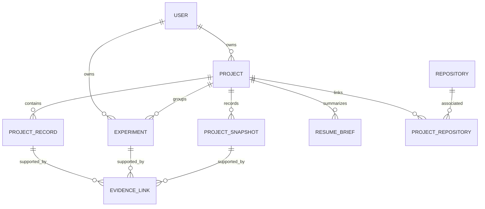

# Data Model and API Contract

> **Status:** Conceptual schema and proposed API.
> **Purpose:** Establish consistent domain boundaries before implementation.
> **Caution:** Field names, constraints and endpoint shapes are candidates, not a frozen database migration.

## 1. Modeling principles

1. Every private record has an unambiguous owner.
2. A project may have zero, one or many repository associations.
3. An experiment may be standalone or associated with a project.
4. Historical context is preserved; changing current project metadata must not rewrite old events.
5. Dated snapshots and Resume Briefs retain their source cutoff and creation time.
6. Clients can create local records before the server assigns canonical synchronization metadata.
7. AI output is not authoritative historical evidence.

## 2. Core entities

### User and account

Authentication provider data should be owned by the authentication system. BuildTrace's domain tables reference the authenticated user through an owner identifier.

### Project

Candidate fields:

| Field | Purpose |
| --- | --- |
| `id` | Stable project identifier |
| `owner_id` | Owning user |
| `name` | Project name |
| `purpose` | Why the project exists |
| `description` | Additional context |
| `project_type` | Product, prototype, learning exercise, contribution, experiment or other |
| `status` | Idea, Active, Paused, Archived, Completed or validated alternative |
| `created_at` | Server creation timestamp |
| `updated_at` | Last canonical metadata update |
| `version` | Optimistic-concurrency version |
| `archived_at` | When archive state was applied, if applicable |

The UI may show a calculated last-activity value. Do not rely on a mutable client clock as the authoritative ordering source.

### Repository

Candidate fields:

- `id`
- `owner_id`
- `provider`
- `repository_url`
- `provider_repository_id`, when available
- `display_name`
- Visibility metadata, when known
- `created_at`
- `updated_at`

Use a join entity such as `project_repositories` to associate projects and repositories. This allows one project to link multiple repositories and a repository to be associated with more than one project when the user explicitly chooses that relationship.

### Project record / timeline event

A project record captures a meaningful event or piece of context.

Candidate fields:

| Field | Purpose |
| --- | --- |
| `id` | Stable record identifier |
| `owner_id` | Record owner |
| `project_id` | Optional project association |
| `record_type` | Decision, milestone, lesson, blocker, handover, status change or note |
| `title` | Short label |
| `body` | Human-readable context |
| `occurred_at` | When the event happened |
| `created_at` | When it was recorded |
| `source_type` | Manual, imported, integration or generated |
| `source_reference` | Optional reference to supporting source |
| `supersedes_record_id` | Optional correction/replacement relationship |
| `version` | Mutable metadata version, if edits are permitted |

A standalone record can have a null project association only where product rules explicitly allow it. Standalone experiments should remain first-class rather than being forced into a fake project.

### Experiment

An experiment should have structured fields:

- `id` and `owner_id`
- Optional `project_id`
- `title`
- `question`
- `hypothesis`
- `technology_or_approach`
- `environment`
- `procedure`
- `result`
- `outcome`: succeeded, failed, inconclusive or not yet evaluated
- `conclusion`
- `lesson`
- `revisit_decision`
- `started_at` and `completed_at`
- `created_at` and `updated_at`

An experiment may generate timeline events, but its structured result should remain directly queryable.

### Evidence

Evidence points to material supporting a record or experiment.

Candidate fields:

- `id` and `owner_id`
- `evidence_type`: repository, commit, pull request, issue, document, URL, attachment or other
- URI or object-storage key
- Title/label
- Optional captured metadata
- `created_at`

Use a relationship table to attach evidence to projects, records, experiments, snapshots or Resume Briefs. Validate URL schemes and do not treat a link as proof that the content remains available.

### Snapshot

A snapshot is a dated statement of the known project state:

- `id` and `owner_id`
- `project_id`
- `working_state`
- `not_working`
- `current_focus`
- `known_limitations`
- `blockers`
- `open_questions`
- `next_action`
- `created_at`
- `source_record_ids` or equivalent evidence references

Snapshots are historical. A newer snapshot does not erase an earlier one.

### Resume Brief

A Resume Brief is a versioned summary derived from a defined source set.

Candidate fields:

- `id` and `owner_id`
- `project_id`
- `snapshot_id`, if used
- `generated_at`
- `source_cutoff` / source cursor
- Generator type and version
- Content
- Facts and suggestions kept distinguishable
- `source_record_ids`
- `stale_after` or freshness metadata, if a policy is later defined

Retain the original source references. A new brief should not silently overwrite the previous brief.

### Sync device and operation

A sync device represents a signed-in client installation. A sync operation represents one requested mutation.

Candidate operation fields:

- `operation_id` generated by the client
- Authenticated `owner_id` derived by the server
- `device_id`
- `entity_type` and `entity_id`
- `mutation_type`
- `base_version`
- `payload`
- `client_created_at`
- `server_received_at`
- Result status
- `server_change_sequence`, when accepted

The operation ID is an idempotency key. Do not trust owner IDs or permissions in the payload.

## 3. Relationships

This is a conceptual ER model. The final relational schema should be normalized according to query patterns and retention rules.

## 4. Historical integrity rules

- A normal project edit updates the current project representation, not the historical events that explain earlier decisions.
- Material corrections to history should create a correction or superseding record with a link to the earlier record.
- Deleting a project should not cascade-delete all history without an explicit, confirmed user deletion workflow.
- Archive is a lifecycle state, not a deletion operation.
- A Resume Brief must retain the source cutoff and source-record references used to create it.
- Imported metadata must be labelled as imported; it must not be presented as a human-authored decision.

## 5. Proposed API conventions

- Base path: `/v1`
- JSON request and response bodies.
- Authentication context determines the user and owner.
- Validate request bodies and query parameters.
- Return stable machine-readable error codes.
- Use explicit pagination for timeline and search endpoints.
- Use idempotency keys for retryable mutations.
- Publish an OpenAPI contract generated from the API definitions.

## 6. Initial endpoint proposal

| Method and route | Purpose |
| --- | --- |
| `GET /v1/vault` | List and filter the user's projects |
| `POST /v1/projects` | Create a project |
| `GET /v1/projects/:id` | Retrieve a project |
| `PATCH /v1/projects/:id` | Update project metadata with version checking |
| `GET /v1/projects/:id/timeline` | Retrieve paginated project history |
| `POST /v1/projects/:id/records` | Create a project record |
| `POST /v1/experiments` | Create a standalone or project-linked experiment |
| `GET /v1/experiments/:id` | Retrieve an experiment |
| `POST /v1/projects/:id/snapshots` | Create a dated project snapshot |
| `POST /v1/projects/:id/resume-briefs` | Create a Resume Brief |
| `GET /v1/projects/:id/resume-briefs` | List available briefs |
| `POST /v1/repositories` | Add a repository reference |
| `POST /v1/sync/push` | Submit queued client operations |
| `GET /v1/sync/pull` | Pull server changes after a cursor |
| `POST /v1/exports` | Request a portable export |

Routes may be consolidated or split once the domain operations are implemented. The table is an API design starting point, not an instruction to create every route immediately.

## 7. Synchronization contract

### Push

The client submits one or more operations with stable operation IDs. The server:

1. Authenticates the session.
2. Derives the owner from the session.
3. Checks operation IDs for prior successful processing.
4. Validates the entity and payload.
5. Checks the submitted base version where relevant.
6. Commits the accepted change and a corresponding server sequence.
7. Returns per-operation accepted, duplicate, rejected or conflict results.

An operation rejected for validation or conflict must not be reported as synchronized.

### Pull

The client supplies its last committed server cursor. The server returns ordered changes, including tombstones, and a next cursor. The client applies the batch locally before advancing its cursor.

A cursor must be stable under concurrent writes. A timestamp alone is not sufficient as a robust cursor unless ties and late-arriving events are handled.

### Conflict handling

- Append-only event creation should avoid unnecessary conflict coupling.
- Concurrent updates to the same project metadata version should return a conflict response.
- The client should show the server value and local proposed value before resolving.
- Never silently discard a user's offline edit.
- Provide a full-resync path if the cursor is no longer valid.

See [Offline Synchronization and Conflict Resolution](../engineering/OFFLINE_SYNC.md) for the detailed protocol.

## 8. Search

Start with PostgreSQL text search and indexes appropriate to actual query patterns. Defer a dedicated search engine until measured scale or relevance requirements justify it.

Search results must remain scoped to the authenticated owner.

## 9. Error model

Define stable error codes, for example:

- `UNAUTHENTICATED`
- `FORBIDDEN`
- `NOT_FOUND`
- `VALIDATION_FAILED`
- `VERSION_CONFLICT`
- `IDEMPOTENCY_KEY_REUSED`
- `SYNC_CURSOR_EXPIRED`
- `RATE_LIMITED`
- `INTERNAL_ERROR`

Responses should include a request/correlation ID, but must not expose secrets or another user's record metadata.

## 10. Schema questions to resolve

- Whether projects can be shared in a later release and how ownership changes.
- Whether experiments should have their own table or share common fields with timeline records.
- Which historical fields are editable and which require correction records.
- How attachments are retained and deleted.
- Whether evidence metadata is snapshotted or fetched on demand.
- How long sync operation and tombstone records must be retained.
- Exact pagination and cursor format.

## 11. Portability and free/open-source constraints

The data and API design must support the approved free/open-source model:

- Do not introduce subscription, billing, ad-targeting or paid-feature entitlement entities into the core domain model.
- Users must be able to export projects, records, experiments, repository references, evidence metadata and snapshots in a documented portable format.
- Export must not require an active paid account or a paid AI provider.
- Self-hosted deployments must be able to use the documented API and database schema without a proprietary licensing check.
- Account deletion must remove the user's data according to the published retention and backup policy, including a clear explanation of backup expiry.
- The service must not sell user records or use private project content for advertising.

The proposed AGPL-3.0-or-later license and voluntary-donation funding policy are documented in the [Open Source, Licensing and Funding Policy](../policies/OPEN_SOURCE_FUNDING.md).

## 12. Related synchronization contract

The proposed offline protocol, operation envelope, idempotency requirements, cursor model, version checks, tombstones and conflict-resolution behaviour are defined in the [Offline Synchronization and Conflict Resolution Specification](../engineering/OFFLINE_SYNC.md).

The data model must support stable client-generated IDs, server versions for mutable entities, append-only historical events, idempotent operation IDs, account-scoped change cursors and deletion tombstones.

Final column names, constraints and indexes remain subject to the Phase 0 schema spike.
