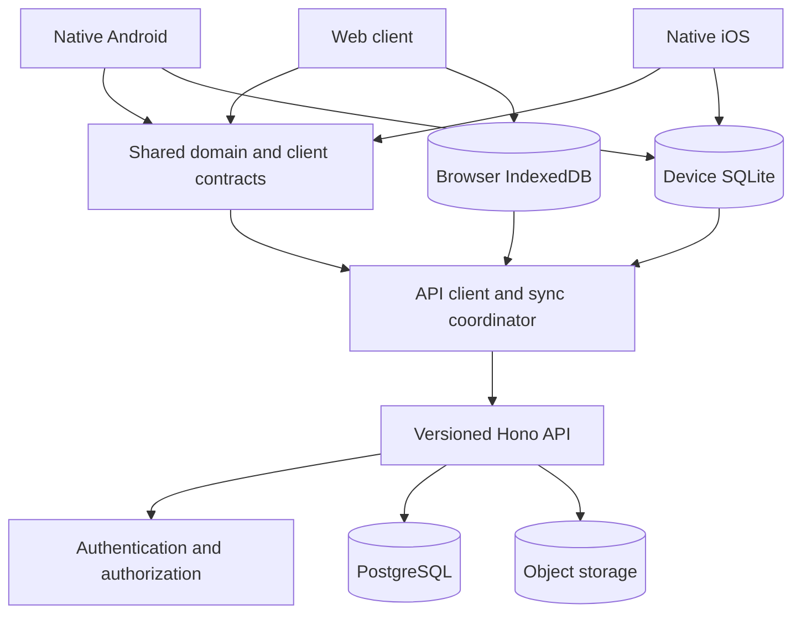

# Technology Stack and System Architecture

> **Status:** Proposed architecture; final implementation design depends on Phase 0 validation.
> **Rule:** Every technology below is a candidate until compatibility testing and product validation justify it.
> **Hosting direction:** Render for temporary staging/previews; NEXVARIN for intended production after acceptance.

## 1. Architecture objectives

The architecture must support:

1. A browser-based web application.
2. Native Android and iOS applications.
3. Shared product semantics, validation and account/data ownership.
4. Offline capture with reliable synchronization.
5. A repository-agnostic project vault.
6. Evidence-linked history and future optional AI features.
7. Portable data and a replaceable integration layer.

## 2. Recommended starting stack

BuildTrace should use separate web and native application shells, with shared TypeScript domain logic, contracts and synchronization code. This avoids forcing one UI/runtime strategy onto every platform while keeping product behaviour consistent.

| Layer | Proposed technology | Responsibility and caveat |
| --- | --- | --- |
| Web application | Next.js + React + TypeScript | Browser-first workspace for desktop and mobile browsers. Separate from the Expo mobile app. |
| Web styling | Tailwind CSS | Responsive web presentation; shared design tokens should remain framework-independent. |
| Web local persistence | IndexedDB, preferably through Dexie | Browser cache, drafts and durable pending changes. |
| Native mobile framework | Expo + React Native + TypeScript | Installable Android and iOS applications; not WebView wrappers. |
| Native navigation | Expo Router | File-based navigation and deep-link handling. |
| Native local database | `expo-sqlite` | Persistent project data, drafts and an outgoing synchronization queue. |
| Native secure storage | `expo-secure-store` | Sensitive local credentials or session material according to the final authentication design. |
| Native files and sharing | `expo-file-system` + `expo-sharing` | Local attachment/export handling and platform share sheets where supported. |
| Shared domain and validation | TypeScript + Zod | Domain rules, entity types and runtime validation shared across clients and API. |
| Shared server-state layer | TanStack Query | Remote fetching, cache invalidation and request lifecycle; not a replacement for durable offline synchronization. |
| Shared UI state | Zustand, only where needed | Lightweight transient client state. Avoid duplicating server or durable domain state. |
| API | Hono + TypeScript | Versioned HTTP API and server-side business logic; package as a portable Node.js/Docker service. |
| Authentication | Better Auth | Preferred candidate; web and native session handling must be proven. |
| Database | PostgreSQL; Neon is the current hosted candidate | Canonical cloud records, relationships, ownership and sync metadata. Provider selection is not final. |
| ORM and migrations | Drizzle ORM | Server-side PostgreSQL schema, typed queries and migrations. |
| Object storage | S3-compatible storage; Cloudflare R2 is a candidate | Attachments and generated exports, separate from relational records. |
| Native build/release | Expo Build | Candidate hosted compilation and distribution workflow for Android and iOS. |
| Testing | Vitest, Playwright and a native E2E tool such as Maestro | Domain/API tests, web browser tests and native-device coverage. Final choices depend on the proven client setup. |
| Monorepo | pnpm workspaces | Shared packages and separate application shells without unnecessary build orchestration. |

Do not pin exact dependency versions in this proposal. Choose a mutually compatible, supported version set during the technical spike and record it in the lockfile.

### Proposed workspace layout

| Path | Responsibility |
| --- | --- |
| `apps/web` | Next.js web client |
| `apps/mobile` | Expo/React Native Android and iOS client |
| `apps/api` | Hono backend API |
| `packages/domain` | Shared project, record and experiment rules |
| `packages/contracts` | Shared validation schemas and API contracts |
| `packages/api-client` | Typed API client |
| `packages/sync` | Shared synchronization protocol and conflict semantics |
| `packages/design-tokens` | Framework-independent visual tokens |
| `packages/config` | Shared TypeScript and lint configuration |

Useful primary documentation:

- [Next.js](https://nextjs.org/docs)
- [React](https://react.dev/learn)
- [Tailwind CSS](https://tailwindcss.com/docs)
- [Expo documentation](https://docs.expo.dev/)
- [Expo Router](https://docs.expo.dev/router/introduction/)
- [React Native](https://reactnative.dev/docs/getting-started)
- [Expo SQLite](https://docs.expo.dev/versions/latest/sdk/sqlite/)
- [Expo SecureStore](https://docs.expo.dev/versions/latest/sdk/securestore/)
- [Expo FileSystem](https://docs.expo.dev/versions/latest/sdk/filesystem/)
- [Expo Sharing](https://docs.expo.dev/versions/latest/sdk/sharing/)
- [Dexie](https://dexie.org/docs/)
- [Hono](https://hono.dev/docs/)
- [Better Auth](https://www.better-auth.com/docs)
- [Neon documentation](https://neon.com/docs)
- [Drizzle ORM](https://orm.drizzle.team/docs/overview)
- [Cloudflare R2](https://developers.cloudflare.com/r2/)
- [Expo Build](https://docs.expo.dev/build/)

## 3. Proposed system topology



The web and native applications share the same domain rules and API contracts. Each client has an appropriate local persistence mechanism. The server validates and authorizes changes before they become canonical cloud records.

## 4. Proposed monorepo

```text
BuildTrace/
├── apps/
│   ├── web/                  # Next.js web application
│   ├── mobile/               # Expo: native Android and iOS applications
│   └── api/                  # Hono API service
├── packages/
│   ├── domain/               # Domain entities and business rules
│   ├── contracts/            # Zod request/response schemas
│   ├── database/             # Drizzle schema and migrations
│   ├── sync/                 # Shared sync contracts and helpers
│   ├── design-tokens/        # Shared design tokens
│   └── config/               # Shared TypeScript and lint configuration
├── docs/
│   ├── product/
│   ├── design/
│   ├── architecture/
│   ├── engineering/
│   ├── project/
│   ├── policies/
│   └── decisions/
├── .github/
├── package.json
└── pnpm-workspace.yaml
```

This is a logical starting layout, not a requirement to create every package on day one. Keep the repository small until real code needs the boundaries.

## 5. Client responsibilities

### Web

- Full project-vault management and search.
- Detailed timeline and experiment inspection.
- Editing project metadata and snapshots.
- Export and bulk organization.
- Responsive usability on narrow browser widths.
- Browser-local draft persistence and queued changes.

### Android and iOS

- Native project browsing and record capture.
- Local persistence for drafts and recent project data.
- Offline capture and deferred synchronization.
- Native sharing and file-selection capabilities where useful.
- Deep links to projects and records.
- Push notifications only when a later workflow justifies them.

Do not wrap the website in a WebView and call it a native application. Native navigation, input behaviour, persistence and operating-system integrations must be implemented and tested as native app experiences.

## 6. API and server responsibilities

The API is the authority for:

- Authentication and identity.
- Authorization and ownership checks.
- Domain validation.
- Canonical cloud persistence.
- Idempotent mutation handling.
- Conflict detection and synchronization cursors.
- Integration credential access.
- Attachment authorization and signed upload/download flows.
- Audit and operational events.

Keep business rules out of UI components. The API must not trust a user ID, owner ID or role supplied by a client payload.

## 7. Offline and synchronization design

Use an **offline-capable, server-canonical model** initially. Do not begin with peer-to-peer replication or a complex CRDT system.

### Local write flow

1. A user creates or edits an allowed record.
2. The client validates the input and persists it locally.
3. The client places a mutation in a durable outgoing queue.
4. The UI displays a pending-sync state.
5. When online, the client submits queued operations with a stable operation ID and the base entity version.
6. The API authenticates the user, validates the payload and checks the base version.
7. Accepted changes are committed once and assigned a server change sequence.
8. The client acknowledges the operation and advances its sync cursor.

### Pull flow

1. The client requests server changes after its last successful cursor.
2. The server returns changes in sequence order, including deletion tombstones.
3. The client applies changes transactionally to its local store.
4. The cursor advances only after the local transaction succeeds.

### Conflict policy

- Retrying the same operation ID must not create duplicate records.
- Concurrent append-only timeline records should usually coexist.
- Conflicting edits to project metadata must be detected, not silently resolved with last-write-wins.
- The API should return the server version and enough information for the client to present a resolution.
- Deletions must propagate as tombstones until all relevant clients can observe them.
- The system must handle expired cursors by requiring a full or scoped resynchronization.

The first offline scope should prioritize creating text records and reading recently cached project data. Full offline editing of every object can be expanded after the basic queue and conflict behaviour are proven.

See [Offline Synchronization and Conflict Resolution](../engineering/OFFLINE_SYNC.md) for the detailed protocol.

## 8. Authentication and session compatibility

Better Auth is the preferred candidate, not a final dependency decision.

Before implementation, prove:

- Sign-in and sign-out on web, Android and iOS.
- Session restoration after app restart.
- Secure native token/session storage.
- Correct cookie or bearer behaviour for the selected API topology.
- Deep-link and OAuth callback behaviour if social login is enabled.
- Session expiry and revocation behaviour.
- Consistent authorization across all three client modes.

Do not store long-lived credentials in ordinary project records or unencrypted local preferences.

## 9. Database and storage boundaries

- PostgreSQL stores canonical structured records and relationships.
- Local SQLite and IndexedDB store client caches, drafts and sync queues.
- Object storage holds attachment bytes and generated exports.
- The database stores attachment metadata and authorized object references, not arbitrary public file URLs as permission controls.
- Integration secrets belong in a dedicated encrypted credential store or an equivalent managed secret mechanism.

### Hosting strategy

**Approved direction:** Render is the temporary non-production staging and preview host while NEXVARIN is being completed. NEXVARIN is the intended long-term production platform for BuildTrace.

This is a target decision, not a claim that NEXVARIN currently satisfies production requirements.

Keep the application deployable as a portable OCI/Docker container with provider-neutral configuration. Keep PostgreSQL and object storage independently configurable so changing the application host does not force a database or file-storage migration.

Before production is moved to NEXVARIN, demonstrate all of the following:

- OCI/Docker container deployment and reproducible releases.
- Reliable PostgreSQL connectivity and secure network access.
- Durable object storage for user files and exports, with a documented migration path.
- Secure environment-variable and secret injection, separated by environment.
- Custom domains and managed TLS.
- Health checks, process restarts and controlled deployment/rollback behaviour.
- Application logs, operational metrics and actionable service-health visibility.
- Automated database backups plus a tested restore procedure; object-storage backup/versioning policy.
- GitHub-based deployment automation with protected production approval.
- Sufficient resource limits and capacity for the expected initial workload.

Do not make the production cutover until these checks pass end to end. If a requirement is not met, keep the production decision gated and revise the infrastructure plan rather than treating an unfinished platform as production-ready.

See [ADR 0001 — Hosting Strategy](../decisions/0001-hosting-strategy.md).

## 10. AI boundary

AI is optional and must sit behind a provider-neutral service interface.

Potential future operations:

- Summarize selected project records.
- Draft a Resume Brief.
- Extract structured experiment fields from user notes.
- Answer questions over the user's authorized project history.

The AI service must receive only the data needed for the requested operation. Outputs must preserve source-record references, separate facts from suggestions and never silently mutate historical records.

The product must remain useful if every AI provider is unavailable.

## 11. Security architecture requirements

- Enforce ownership checks on every project and record operation.
- Use least-privilege OAuth scopes for repository integrations.
- Encrypt sensitive credentials at rest and restrict their access.
- Use short-lived signed object URLs for private attachments.
- Avoid logging project bodies, tokens or sensitive attachment contents.
- Apply rate limits and request validation at the API boundary.
- Provide export, account deletion and backup/recovery procedures.
- Threat-model cross-account access, stolen sessions, malicious attachment links and sync replay.

## 12. Technical spikes required before stack approval

1. Build the Next.js web application and the Expo/React Native mobile application as separate clients in the same workspace.
2. Verify routing and platform-specific components on all three targets.
3. Test Better Auth session flows on web and physical Android/iOS devices.
4. Persist a record locally using Expo SQLite on native and IndexedDB/Dexie on web.
5. Queue an offline mutation, reconnect and sync it exactly once.
6. Simulate concurrent edits and verify conflict reporting.
7. Run the same Zod/domain validation on client and API.
8. Build and distribute a native test build using the intended release workflow.
9. Build and deploy a portable web/API container to the staging environment.

## 13. Decisions still open

- Exact Expo, React Native and Better Auth version combination.
- Whether web and native use one shared UI system or more platform-specific screens.
- Exact sync cursor and versioning implementation.
- Object-storage provider.
- Search implementation once the dataset and query needs are known.
- Native push-notification scope.
- Whether desktop-native builds are justified later.
- Exact API process topology and resource requirements.

The hosting direction is settled, but the actual NEXVARIN production capability remains subject to its acceptance checklist.

No production code should depend on an untested compatibility assumption.

## 14. Open-source licensing, funding and hosting constraints

- The proposed application and backend license is AGPL-3.0-or-later, subject to legal review, dependency compatibility and app-distribution review.
- There must be no subscription, paid feature tier, advertisement system, data-sale model or payment entitlement logic in the core product architecture.
- Voluntary donations are the proposed funding source. Donations must not change feature access or product permissions.
- The intended official hosted service is free to use. Hosting, database, storage, backups and distribution still have real operating costs; service capacity must be planned around available funding rather than promising unlimited usage.
- Self-hosters may choose and pay their own infrastructure providers. This is an operator cost, not a BuildTrace license fee.
- No core workflow may depend on a paid AI API or other mandatory paid third-party service.
- Design for provider portability, export and self-hosting so that changes in funding or infrastructure do not trap user data.

See [Open Source, Licensing and Funding Policy](../policies/OPEN_SOURCE_FUNDING.md).

## 15. Companion specifications

- [Product Requirements Document](../product/PRD.md)
- [Data Model and API Contract](./DATA_MODEL_API.md)
- [Web and Native Experience](../product/PLATFORM_EXPERIENCE.md)
- [UX Screen Map and Low-Fidelity Wireframes](../design/UX_SCREEN_MAP.md)
- [Offline Synchronization and Conflict Resolution](../engineering/OFFLINE_SYNC.md)
- [Development Environment and CI/CD Pipeline](../engineering/DEVELOPMENT_PIPELINE.md)
- [Delivery, Validation and Testing Plan](../project/DELIVERY_PLAN.md)
